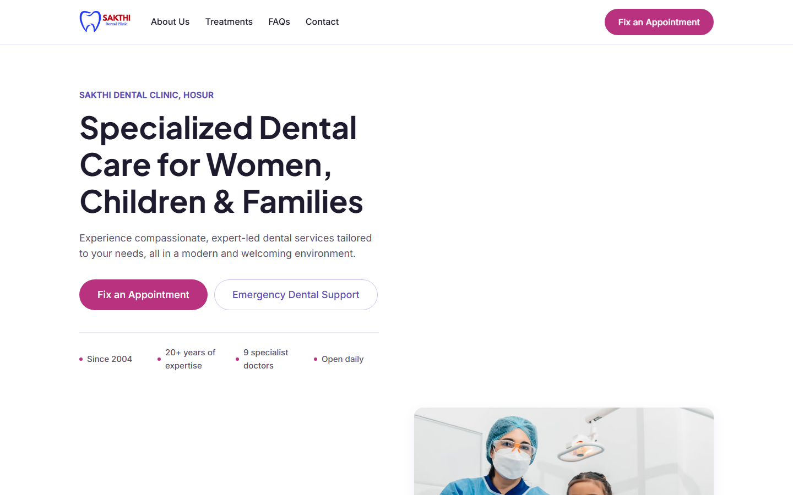
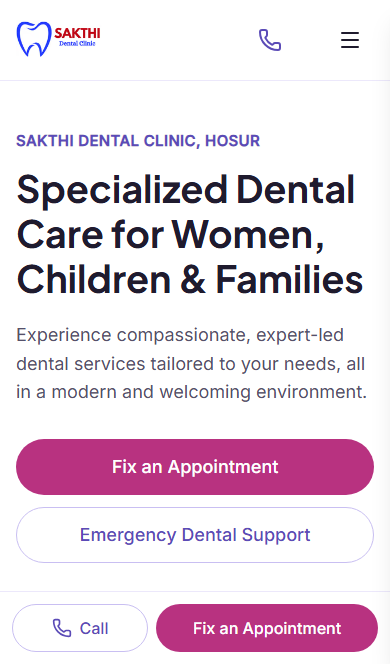
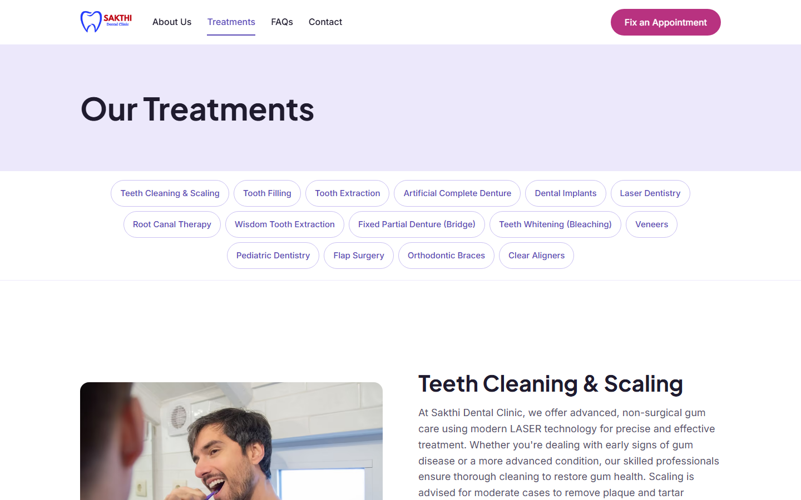
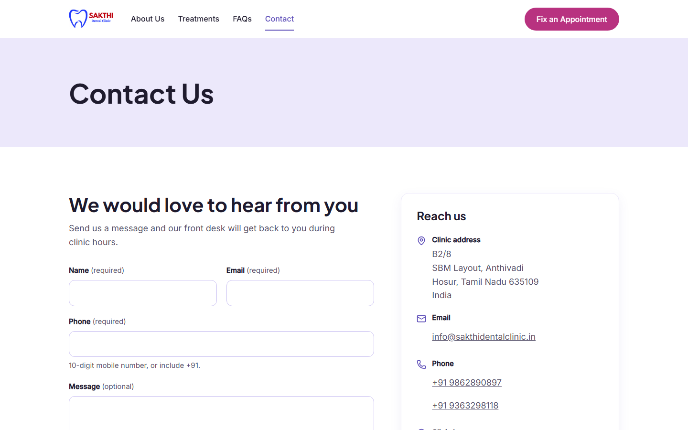
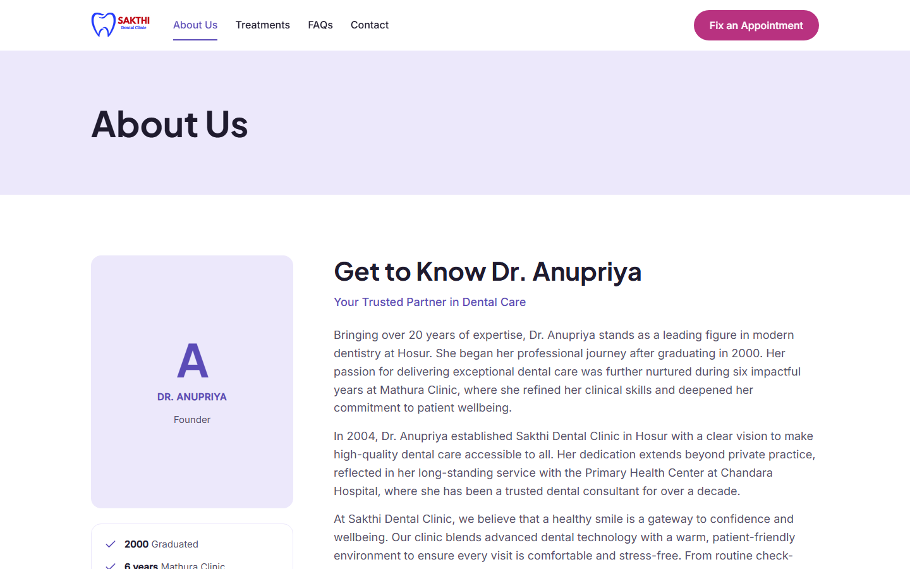

# Sakthi Dental Clinic — Website

**Live site:** https://shadowfox-rho-liart.vercel.app

A production-style, seven-page marketing website for **Sakthi Dental Clinic, Hosur**, designed and built end to end on the MERN stack as the deliverable for a **virtual internship at ShadowFox**.

The site is content-driven, mobile-first, accessible, prerendered for speed, and backed by a small Express/MongoDB API that stores appointment enquiries. Everything the clinic needs to change later lives in one seed file or in MongoDB — not in markup.

**Repository:** [github.com/DurgeshGatkal/sakthi-dental-clinic-website-shadowfox](https://github.com/DurgeshGatkal/sakthi-dental-clinic-website-shadowfox)

|               |                                                                                                   |
| ------------- | ------------------------------------------------------------------------------------------------- |
| **Client**    | Sakthi Dental Clinic, Hosur, Tamil Nadu                                                           |
| **Programme** | Virtual Internship — Web Development, ShadowFox                                                   |
| **Task**      | Build the clinic's official 7-page marketing website from the client brief                        |
| **Stack**     | React 19, React Router 7, Vite 8, Tailwind CSS 4, Express 5, MongoDB 8, Node 24                   |
| **Status**    | Days 1–9 complete and tested; Day 10 deployment pending                                           |
| **Quality**   | 36 API tests, 190 browser checks across 5 profiles, axe clean, Lighthouse 91–95 / 100 / 100 / 100 |
| **Live URL**  | https://shadowfox-rho-liart.vercel.app                                                            |

---

## Screenshots

| Home — desktop                                             | Home — mobile                                             |
| ---------------------------------------------------------- | --------------------------------------------------------- |
|  |  |

| Treatments                                          | Contact                                                        |
| --------------------------------------------------- | -------------------------------------------------------------- |
|  |  |

| About                                     |
| ----------------------------------------- |
|  |

---

## The internship brief

ShadowFox assigned a client-project simulation: take a real brief from Sakthi Dental Clinic and deliver the public website within a ten-day plan, with three review gates.

**The task, in the client's words:** a warm, professional, mobile-first website that helps people in and around Hosur find the clinic, understand its treatments, and get in touch — with clear calls to action for appointments and emergency dental support.

**What I owned**

- The full design system and page designs (lavender/pink palette, typography scale, components).
- The MERN implementation: MongoDB models, seed data, Express API, React Router frontend.
- Every piece of copy placed from the client's brief — nothing invented, especially not doctor credentials.
- Responsive behaviour from 320 px to 1440 px, WCAG 2.2 AA accessibility, SEO, image optimisation.
- Automated testing, performance budgets, documentation and handover.

**Ten-day plan and gates**

| Phase      | Days | Outcome                                                                    |
| ---------- | ---- | -------------------------------------------------------------------------- |
| Foundation | 1–2  | Workspaces, data model, seed content, design tokens, Gate 1 design preview |
| Build      | 3–6  | API, shell, all six content pages and the 404 (Gate 2)                     |
| Polish     | 7–8  | Responsive and accessibility pass, SEO, image pipeline, Lighthouse gate    |
| Prove      | 9    | End-to-end tests, axe audit, proofread, Gate 3                             |
| Ship       | 10   | Deployment, live checks, README and handover                               |

Day 9 is complete and committed. Day 10 — production deployment and the live verification pass — is the remaining step; the pre-launch checklist is at the end of this document.

---

## What the website does

| Page           | Route             | Purpose                                                                                                                    |
| -------------- | ----------------- | -------------------------------------------------------------------------------------------------------------------------- |
| Home           | `/`               | Hero, trust signals, four reasons to choose the clinic, six core treatments, testimonial carousel, facilities, closing CTA |
| About          | `/about`          | Clinic story from the founder, credentials, mission and vision, all nine doctors                                           |
| Treatments     | `/treatments`     | Fifteen treatments in brief order, a jump-chip index, anchored sections and a per-treatment CTA                            |
| FAQs           | `/faqs`           | Fourteen common questions in a single-open accordion, plus a "still have questions?" card                                  |
| Contact        | `/contact`        | Validated enquiry form, clinic details, hours, map link and a phone fallback                                               |
| Privacy Policy | `/privacy-policy` | The client's nine-section policy, rendered verbatim from the database                                                      |
| Not found      | any unknown URL   | Branded 404 with real HTTP 404 on static hosting                                                                           |

**Enquiry flow.** Name, email and phone are required; the message is optional. The browser validates with the same Zod schema the API uses, then `POST /api/v1/contact`. The server checks a honeypot, rate-limits to five submissions per fifteen minutes per IP, normalises the phone and email, stores a salted SHA-256 hash of the IP instead of the address, and writes the enquiry to `contact_messages`. A success card replaces the form; if the API is unreachable, the page offers the clinic's phone number instead. Email notifications are **off** in this showcase build (`MAIL_ENABLED=false`), because the address on the site is display copy with no live mailbox.

**Calls to action.** "Fix an Appointment" and "Emergency Dental Support" appear across the site but deliberately contain no booking logic. Both route through one file — [`client/app/components/cta/ctaConfig.ts`](client/app/components/cta/ctaConfig.ts) — so the clinic can point them at a booking page, WhatsApp number or phone line without touching a single component.

**Content, not hard-coding.** Clinic details, treatments, doctors, testimonials, FAQs, amenities, why-choose cards and the privacy policy all come from MongoDB. The source of truth for a fresh database is [`server/src/seed/content.json`](server/src/seed/content.json).

---

## Architecture

```
                            BUILD TIME
  content.json ── npm run seed ──► MongoDB ──► React Router prerender ──► HTML
                                                                          │
                            RUNTIME                                       │
  ┌──────────────────────────────┐        ┌──────────────────────────┐    │
  │  Visitor's browser           │        │  Static host / CDN       │◄───┘
  │  React 19 + Router 7         │◄───────│  6 pages + 404.html      │
  │  hydrated, client navigation │        │  hashed assets, AVIF/WebP│
  └──────────────┬───────────────┘        └──────────────────────────┘
                 │  fetch  GET /api/v1/*   POST /api/v1/contact
                 ▼
  ┌──────────────────────────────────────────────────────────────────┐
  │  Express 5 API                                                   │
  │  requestId → pino → helmet → CORS → compression → JSON (10 kb)   │
  │  → rate limit → routes → zod validation → controllers/services   │
  └──────────────┬───────────────────────────────┬───────────────────┘
                 │                               │
                 ▼                               ▼
  ┌──────────────────────────────┐   ┌──────────────────────────────┐
  │  MongoDB                     │   │  SMTP (optional, off by       │
  │  7 content collections       │   │  default in this build)       │
  │  + contact_messages (TTL)    │   └──────────────────────────────┘
  └──────────────────────────────┘
```

**Why this shape**

- **Prerender first, hydrate after.** React Router 7 runs in framework mode. All public routes are rendered to HTML at build time against the seeded API, so the first paint needs no JavaScript and every page has real content for search engines. Client-side navigation then behaves like an app.
- **One source of truth for copy.** The API is read-only for content; the seed file is the editable master. Re-seeding is upsert-based, so it never deletes saved enquiries.
- **A deliberately small API surface.** Ten endpoints, no CMS, no auth — the smallest backend that keeps content editable and the form honest.
- **Shared validation.** `@sakthi/shared` exports the Zod schemas used by both the browser form and the Express validator, so a rule can never drift between the two.
- **Lean public bundle.** Constants live behind the `@sakthi/shared/site` subpath, keeping Zod and React Hook Form off every route except `/contact`.

### Repository layout

```
sakthi-dental-clinic/
├── client/                     # React Router 7 app (SSR + prerender)
│   ├── app/
│   │   ├── components/         # layout, home, about, treatments, contact, cta
│   │   ├── lib/                # API client, SEO/JSON-LD, helpers
│   │   ├── routes/             # one module per page + 404 twins
│   │   ├── root.tsx            # document shell, header, footer, mobile bar
│   │   └── routes.ts           # route table
│   ├── public/                 # client logos, banners, treatment photos, icons
│   └── react-router.config.ts  # SSR + the prerender list
├── server/                     # Express 5 API
│   └── src/
│       ├── config/             # validated environment
│       ├── controllers/        # thin HTTP layer
│       ├── middleware/         # request ID, rate limit, validation, errors
│       ├── models/             # eight Mongoose models
│       ├── routes/             # health, content, contact
│       ├── seed/               # content.json + idempotent seed script
│       ├── services/           # content, contact, mail
│       └── utils/              # logger, AppError, IP hashing
├── shared/                     # Zod schemas + site constants (plain ESM JS)
├── e2e/                        # Playwright specs (navigation, pages, axe layout)
├── scripts/                    # local DB, build server, SEO, images, audits, 404
├── design/                     # Gate 1 static design preview
├── docs/screenshots/           # images used in this README
├── .github/workflows/ci.yml    # lint, typecheck, tests, build
├── PROGRESS.md                 # day-by-day decisions, fixes, open items
└── CREDITS.md                  # every asset and its licence
```

### Data model

| Collection         | Contents                                                                                                           |
| ------------------ | ------------------------------------------------------------------------------------------------------------------ |
| `clinic_info`      | Single document: identity, address, both phone numbers, email, hours, hero copy, founder story, mission and vision |
| `treatments`       | 15 treatments: slug, title, copy, image, position, home-page selection                                             |
| `doctors`          | 9 doctor cards using only the names, roles and qualifications supplied in the brief                                |
| `testimonials`     | 3 patient quotes and ratings                                                                                       |
| `faqs`             | 14 questions and answers                                                                                           |
| `amenities`        | 5 facility items                                                                                                   |
| `why_choose`       | 4 differentiators for the home page                                                                                |
| `contact_messages` | Enquiries with normalised contact details, a salted IP hash and a 365-day TTL                                      |

### API

| Method | Endpoint                   | Returns                                                          |
| ------ | -------------------------- | ---------------------------------------------------------------- |
| GET    | `/api/v1/health`           | Liveness and database state                                      |
| GET    | `/api/v1/content/home`     | Everything the home page needs in one round trip                 |
| GET    | `/api/v1/clinic`           | Clinic identity, contact details and hours                       |
| GET    | `/api/v1/treatments`       | All treatments in display order                                  |
| GET    | `/api/v1/treatments/:slug` | One treatment                                                    |
| GET    | `/api/v1/doctors`          | Doctor cards                                                     |
| GET    | `/api/v1/testimonials`     | Quotes and ratings                                               |
| GET    | `/api/v1/faqs`             | Questions and answers                                            |
| GET    | `/api/v1/privacy-policy`   | Policy markdown and last-updated date                            |
| POST   | `/api/v1/contact`          | Validates and stores an enquiry (`201`), or field errors (`422`) |

Security and robustness: Helmet with a strict CSP, an explicit CORS allow-list (plus Vercel preview domains), a 10 kB JSON limit, per-IP rate limiting on the contact route only, structured logs with a request ID, no raw IP storage, and a single error shape for every failure.

---

## Tech stack

| Layer          | Choice                                                          | Version |
| -------------- | --------------------------------------------------------------- | ------- |
| Runtime        | Node.js                                                         | 24      |
| UI             | React / React DOM                                               | 19.3    |
| Framework      | React Router (framework mode, SSR + prerender)                  | 7.18    |
| Build          | Vite                                                            | 8.3     |
| Styling        | Tailwind CSS                                                    | 4.3     |
| Fonts          | Inter + Plus Jakarta Sans, self-hosted via Fontsource           | 5.3     |
| Icons          | lucide-react                                                    | 1.61    |
| Forms          | React Hook Form + Zod resolver                                  | 7.90    |
| Validation     | Zod (shared client/server)                                      | 4.1     |
| API            | Express                                                         | 5.3     |
| ODM            | Mongoose                                                        | 8.24    |
| Database       | MongoDB (Atlas M0 in production, local `mongod` in development) | 8.x     |
| Logging        | pino + pino-http                                                | 10.x    |
| Unit/API tests | Vitest + Supertest + mongodb-memory-server                      | 5.x     |
| Browser tests  | Playwright + axe-core                                           | 1.64    |
| Performance    | Lighthouse + chrome-launcher                                    | 13.x    |
| Images         | sharp (AVIF/WebP pipeline)                                      | 0.35    |

No component library and no CSS-in-JS runtime: the design system is a small set of Tailwind tokens and hand-built components.

---

## Getting started

### Prerequisites

- **Node.js 24** and npm 11+
- **MongoDB** — nothing to install for local work; `npm run dev:local` starts a real `mongod` on port 27017 from the cached binary (it fetches it once on first use). Atlas is only needed for the deployed API and the optional `npm run dev`.

### Install and run

```bash
git clone https://github.com/DurgeshGatkal/sakthi-dental-clinic-website-shadowfox.git
cd sakthi-dental-clinic-website-shadowfox

npm install
cp .env.example .env      # Windows: copy .env.example .env

npm run dev:local
```

That single command starts MongoDB, seeds the content, then runs the API and the Vite dev server together:

- Website — http://localhost:5173
- API — http://localhost:4000/api/v1
- Database — `mongodb://127.0.0.1:27017/sakthi_local`

Use `localhost`, not `127.0.0.1`, for the Vite URL: the dev server binds to the IPv6 loopback by default. Data lives in `.local-db/` (git-ignored) and survives restarts; re-seeding never removes saved enquiries.

To use Atlas instead, fill `MONGODB_URI` in `.env`, add your IP in Atlas → Network Access, and run `npm run dev`.

### Environment variables

| Variable                                              | Default                        | Purpose                                                                      |
| ----------------------------------------------------- | ------------------------------ | ---------------------------------------------------------------------------- |
| `NODE_ENV`                                            | `development`                  | Runtime mode                                                                 |
| `PORT`                                                | `4000`                         | API port                                                                     |
| `MONGODB_URI`                                         | —                              | Atlas connection string (used by `npm run dev`, `npm run seed`, `npm start`) |
| `CORS_ORIGINS`                                        | `http://localhost:5173`        | Comma-separated browser origins allowed to call the API                      |
| `MAIL_ENABLED`                                        | `false`                        | Send enquiry notifications by email                                          |
| `SMTP_HOST` / `SMTP_PORT` / `SMTP_USER` / `SMTP_PASS` | —                              | SMTP credentials when mail is enabled                                        |
| `MAIL_TO`                                             | `info@sakthidentalclinic.in`   | Notification recipient                                                       |
| `IP_HASH_SALT`                                        | —                              | Salt for hashing submitter IPs; use a long random value                      |
| `VITE_API_URL`                                        | `http://localhost:4000/api/v1` | API base URL baked into the client                                           |
| `VITE_SITE_URL` / `SITE_URL`                          | `https://sakthidental.in`      | Canonical origin for meta tags, JSON-LD and sitemap                          |

`.env` is git-ignored and has never been committed. Only placeholders belong in `.env.example`.

### Scripts

| Command                           | What it does                                                    |
| --------------------------------- | --------------------------------------------------------------- |
| `npm run dev:local`               | Local MongoDB + seed + API + client (recommended)               |
| `npm run dev`                     | API + client against `MONGODB_URI` (Atlas)                      |
| `npm run seed`                    | Upsert `content.json` into the configured database              |
| `npm run lint` / `lint:fix`       | ESLint 10 across the monorepo                                   |
| `npm run typecheck`               | React Router typegen + TypeScript, per workspace                |
| `npm test`                        | API tests (Vitest) and client tests                             |
| `npm run test:e2e`                | Playwright across Chromium, Firefox, WebKit, Pixel 7, iPhone 14 |
| `npm run test:e2e:report`         | Open the last Playwright HTML report                            |
| `npm run build`                   | SEO files, image variants, React Router build and `404.html`    |
| `npm run format` / `format:check` | Prettier                                                        |

`npm run build` prerenders every route, so it needs the API and a seeded database to be running. The simplest local sequence is: start `npm run dev:local` in one terminal, run `npm run build` in another.

---

## Editing content

1. Edit [`server/src/seed/content.json`](server/src/seed/content.json). It is the only file that holds page copy, contact details, hours, treatments, doctors, FAQs and the privacy policy.
2. Run `npm run seed`. Upserts are keyed by slug/stable identifiers, so existing enquiries are untouched.
3. Refresh the site. Page copy is fetched through the API; treatment images are referenced by path from `client/public/images`.

For production, the same fields can be edited directly in MongoDB Atlas (or with MongoDB Compass) and the site reflects the change on the next request. Rebuild the static pages when changing meta content, since titles and JSON-LD are baked in at build time.

**Images.** Drop a source image into `client/public/images/photos/` (or the relevant folder), reference it in the seed, and the pre-build `scripts/optimize-images.mjs` step generates AVIF and WebP variants at multiple widths with sharp. Generated files are git-ignored.

**Hours, phones, email.** These live in `clinic_info` and in `shared/src/site.js` (the constants used by the header, footer and mobile bar). Keep both in step when they change.

---

## CTA integration point

Both primary buttons are intentionally inert. To wire them up, edit one file:

```ts
// client/app/components/cta/ctaConfig.ts
export const ctaConfig = {
  appointment: () => {
    /* booking page, WhatsApp, or tel: link */
  },
  emergency: () => {
    /* emergency number or WhatsApp */
  },
};
```

Every "Fix an Appointment" and "Emergency Dental Support" button, on every page and in the mobile action bar, calls these two functions. The call buttons already dial the clinic's published numbers.

---

## Testing and quality

| Suite                      | Command                                                                 | Result                                                                                          |
| -------------------------- | ----------------------------------------------------------------------- | ----------------------------------------------------------------------------------------------- |
| API + services             | `npm test`                                                              | **36/36 passing**                                                                               |
| End-to-end + accessibility | `npm run test:e2e`                                                      | **190 checks — 162 passed, 28 intentionally skipped**                                           |
| Accessibility audit        | part of the E2E run                                                     | **axe-core: zero serious or critical violations on 7 documents**                                |
| Performance                | `node scripts/serve-build.mjs` then `node scripts/lighthouse-audit.mjs` | **91–95 Performance; 100 Accessibility, Best Practices, SEO**                                   |
| Responsive audit           | `node scripts/responsive-audit.mjs`                                     | No horizontal scroll, no tap target under 48 px, no type under 15 px across 24 page/width pairs |
| Lint / types               | `npm run lint`, `npm run typecheck`                                     | Clean                                                                                           |

The Playwright suite runs against the **prerendered build**, not the dev server. `scripts/e2e-env.mjs` gives every run a disposable world: a fresh `mongod` on port 27018, the seed loaded, the API on 4000 and the static build on 5000 — then tears it down. Coverage includes every header/footer link, the CTA on all pages, all 15 treatment anchors and chips, the accordion's single-open behaviour, the contact form's required/invalid/unreachable/happy paths (including the database document), the branded 404, the mobile drawer at 320 px, no horizontal overflow at four widths, and axe on every route.

The deliberately skipped checks are the CSS width sweep and the one real database write, which run once on Chromium rather than five times — this also keeps the happy-path submission under the contact rate limit.

**Accessibility.** WCAG 2.2 AA is treated as a build constraint, not a review step: semantic landmarks, one `h1` per page, visible focus rings, a skip link, real `aria-expanded`/`aria-controls` on the accordion, `inert` on the closed mobile drawer, 48 × 48 px controls, 18 px body copy, reduced-motion support, and colour pairs checked for contrast.

**Performance.** The build prerenders HTML, preloads the two LCP fonts, serves AVIF/WebP at responsive widths, keeps the hero image eager and the rest lazy, and splits Zod + React Hook Form onto `/contact` only. Home ships ~267 kB with CLS 0.003 and TBT under 10 ms on Lighthouse's mobile profile.

**SEO.** Per-route titles and descriptions, canonicals, Open Graph and Twitter cards, one shared 1200 × 630 share image, `Dentist` JSON-LD site-wide, `FAQPage` on `/faqs`, `BreadcrumbList` on inner pages, and generated `robots.txt` and `sitemap.xml`.

Two secondary section-14 budgets are now **reported, not gated**: JavaScript per route is 122–128 kB gzipped (160 kB on `/contact`) against a 120 kB target, and LCP is 2.46–2.82 s against 2.5 s on four routes. The release gate itself (Performance 90+, 100/100/100) is green on every route; the two targets stay visible in the audit output so a future optimisation pass can pick them up. The trade-offs are recorded in `PROGRESS.md`.

---

## Deployment

The site is live in production on Vercel (client + serverless API + Atlas). The reference architecture below is what the build follows; production runs both the client and the API on Vercel.

**Client — Vercel (or any static host)**

- Root directory: `client`
- Build: `npm run build` (from the repo root, or configure the monorepo root)
- Output: `client/build/client`
- Environment: `VITE_API_URL=https://<api-host>/api/v1`, `VITE_SITE_URL=https://sakthidental.in`
- `404.html` is generated after the build and served with a real 404 status by Vercel's convention.

**API — Render, Railway, Fly.io or similar**

- Start: `npm start -w @sakthi/server`
- Environment: `MONGODB_URI` (Atlas), `CORS_ORIGINS=https://sakthidental.in`, `IP_HASH_SALT`, `MAIL_ENABLED=false`, `NODE_ENV=production`
- Health check: `/api/v1/health`

**MongoDB Atlas**

- Create a free M0 cluster and a database user.
- Allow the API host's egress address in Network Access; remove stale developer IPs.
- Seed once from a machine that can reach the cluster: `npm run seed`.

**Before launch**

- [ ] `VITE_API_URL` points at the deployed API and that origin is in `CORS_ORIGINS`.
- [x] Atlas connected (build runs against an in-memory Mongo; runtime uses Atlas).
- [x] All seven routes load, and an unknown URL returns HTTP 404.
- [ ] A real enquiry lands in `contact_messages` and appears in the Atlas collection.
- [ ] Canonical URL, sitemap and JSON-LD still point at https://sakthidental.in (custom domain not yet attached).
- [ ] Decide on the two open content issues below (hours, doctor spelling).
- [ ] Keep `MAIL_ENABLED=false` until a real inbox and SMTP credentials exist.

---

## Known limitations and open content items

- **CTAs are placeholders.** No booking integration, by design; see the CTA section above.
- **Showcase contact details.** The email address on the site has no mailbox, and the phone numbers are the clinic's published numbers used as display copy. Email notifications are off.
- **Opening hours conflict in the brief.** The amenities strip says "9 AM – 9 PM"; the footer, contact panel and JSON-LD say 9am–7pm. The site consistently uses `Su-Sa 09:00-19:00`; the client should confirm which is correct.
- **Doctor name spelling.** The brief lists "Dr. Ajay Jumar"; this may be "Kumar". Not changed without client confirmation.
- **No doctor or founder portraits.** The brief supplied no photos, and stock faces under real doctors' names would be misleading, so the design uses monograms and a credential panel.
- **Content gaps from the brief.** No Why Choose intro sentence, no Treatments banner intro, and no static map image. The pages ship without invented copy; Contact uses an "Open in Google Maps" link.
- **Social links** render only once real Instagram, Facebook and YouTube URLs are seeded (they are `#` today, so nothing dead is shown).
- **Email delivery** is implemented and tested but disabled in this build.
- **Mobile QA** used Playwright's Pixel 7 and iPhone 14 profiles; no physical device, NVDA or VoiceOver was available in this environment.

---

## Documentation

| File                                                  | Contents                                                                  |
| ----------------------------------------------------- | ------------------------------------------------------------------------- |
| [`PROGRESS.md`](PROGRESS.md)                          | Day-by-day log, every bug found and fixed, open decisions, handover notes |
| [`docs/QA-REPORT.md`](docs/QA-REPORT.md)              | Test results, known misses and security checks                            |
| [`CREDITS.md`](CREDITS.md)                            | Every client asset, Pexels photo, icon and font with its licence          |
| `Sakthi Dental Clinic — MERN Website Project Plan.md` | The approved plan this build follows, including the requirement matrix    |
| `design/preview.html`                                 | Gate 1 static design preview                                              |

---

## Credits and ownership

- **Client assets** — logo, banners, treatment photos and amenity icons supplied by Sakthi Dental Clinic via ShadowFox; the clinic retains all rights.
- **Photography** — 16 royalty-free photos from Pexels, individually credited with photographer and licence in `CREDITS.md`.
- **Icons** — lucide-react (ISC).
- **Fonts** — Inter and Plus Jakarta Sans via Fontsource (SIL Open Font License).
- **Code** — written during the ShadowFox virtual internship for this client project. The clinic's brand, copy and supplied assets remain the clinic's property; the source is published for internship review and handover, not as a reusable template.

Built with care in Hosur, for Hosur.
